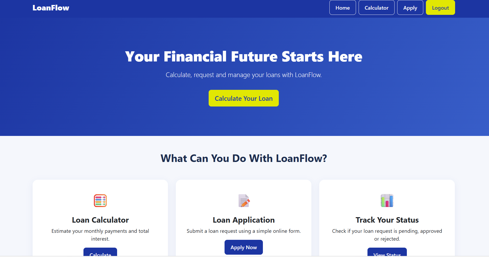

# LoanFlow — Loan Management Application

A web application developed for the Full Stack Development course at ECE Paris.

**Live Website:** https://kiki2212.github.io/ECE/

## Technologies Used
- HTML5 — Website structure
- CSS3 — Custom styling
- Bootstrap 5 — Responsive design and UI components
- JavaScript — Form validation, calculations and button interactions
- JSON & localStorage — Browser-based data storage

## Bootstrap Components Used
- **Navbar:** Navigation between Home, Calculator and Loan Application pages.
- **Buttons:** Login, Sign Up, Calculate, Submit, Approve, Reject and Logout.
- **Cards:** Organize forms, application details and admin statistics.
- **Forms:** Username, password confirmation and loan application inputs.
- **Grid System:** Responsive layouts using `container`, `row`, `col-md-*` and `col-lg-*`.
- **Tables:** Display loan applications and their information.
- **Badges:** Show Pending, Approved and Rejected statuses.
- **Alerts:** Display calculation results and application confirmations.

## Main Features
- User registration and login validation
- Loan calculator with monthly payment and interest calculations
- Loan request submission
- Administrator approval and rejection
- Application status tracking
- JSON data storage using localStorage

## Application Preview

## Project Note
This is an educational prototype. Authentication and data storage are browser-based and are not intended for real financial use.
